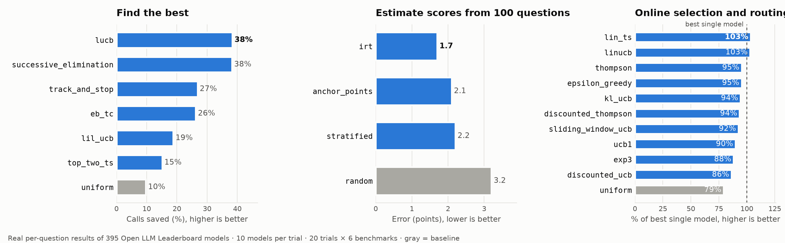

<div align="center">

# frugal-eval

**Cheaper LLM evaluation and online model selection: methods from the research literature behind one interface, benchmarked on real data.**

[](https://github.com/raja-sunkara/frugal-eval/actions/workflows/tests.yml)
[](https://github.com/raja-sunkara/frugal-eval/actions/workflows/benchmark.yml)
[](LICENSE)
[](pyproject.toml)
[](https://colab.research.google.com/github/raja-sunkara/frugal-eval/blob/main/examples/quickstart.ipynb)

</div>

Evaluating LLMs is expensive. Comparing 10 prompts on a 1,000-question test set costs 10,000 calls; serving every request with the strongest model costs even more. The bandits, active-testing and psychometrics literature has good methods for wasting less, but they are scattered across papers, each with its own code. frugal-eval implements them behind one interface and ranks them on the same real data: per-question results of 395 Open LLM Leaderboard models, RouterBench (11 LLMs with real prices) and 56k human votes from Chatbot Arena.

<picture>
  <source media="(prefers-color-scheme: dark)" srcset="docs/benchmark-dark.png">
  
</picture>

| Job | Command | Typical result on real data |
|---|---|---|
| **Find the best** prompt or model | `frugal-eval identify` | certified winner with **38%** fewer calls on average, up to 75% |
| **Estimate** every model's score from a few questions | `frugal-eval estimate` | within **1.7 points** from 100 questions (92% fewer calls on GSM8K) |
| **Route** each request while learning, optionally cost-aware | `frugal-eval route` | **94%** of GPT-4's quality at **23%** of its cost on RouterBench |
| **Compare by votes**: pairwise human or LLM-judge comparisons | `frugal-eval duel` | best of 8 Chatbot Arena models from real human preference rates |

## <div align="center">Quick start</div>

<details open>
<summary>Install</summary>

```bash
pip install git+https://github.com/raja-sunkara/frugal-eval      # Python 3.9+, needs only numpy and httpx
pip install "frugal-eval[routerbench] @ git+https://github.com/raja-sunkara/frugal-eval"   # + RouterBench download
```

</details>

<details open>
<summary>Try every method in 30 seconds (no API key)</summary>

```bash
frugal-eval demo                     # all methods on real leaderboard data
frugal-eval methods                  # every method with its paper, and every built-in task
```

Or open the [Colab notebook](https://colab.research.google.com/github/raja-sunkara/frugal-eval/blob/main/examples/quickstart.ipynb).

</details>

<details open>
<summary>Command line</summary>

```bash
frugal-eval identify --task leaderboard/gsm8k --method lucb           # find the best with few calls
frugal-eval identify --csv my_scores.csv                              # ... on your own scores
frugal-eval estimate --task leaderboard/mmlu --method irt --budget 100
frugal-eval route    --task routerbench --method linucb --cost-weight 0.5
frugal-eval route    --task drift/mmlu --method sliding_window_ucb    # a model silently degrades mid-stream
frugal-eval duel     --task arena --method borda_lucb                 # pairwise votes
```

</details>

<details open>
<summary>Python</summary>

```python
import frugal_eval as fe

task = fe.tasks.make("leaderboard/gsm8k", n_candidates=10, seed=0)   # 10 real models, 1,319 questions

fe.identify(task, method="lucb").summary()               # find the best with few calls
fe.estimate(task, method="irt", budget=100).summary()    # estimate every score from 100 questions
fe.run_online(task, method="linucb").summary()           # route each question while learning
fe.find_best_pairwise(fe.duel.arena(8)).summary()        # best of 8 Arena models from pairwise votes
```

Real output of `fe.identify(task, method="lucb")`:

```
candidate                              score           interval   examples
NeuralPipe-7B-slerp                    0.675  [ 0.629,  0.721]  1044/1319  <- best
Tess-M-v1.3                            0.579  [ 0.533,  0.624]  1044/1319
alpaca-lora-65b-en-pt-es-ca            0.254  [ 0.088,  0.419]   268/1319
...
Best: NeuralPipe-7B-slerp
Certified: best within 0 with probability >= 0.95.
Calls: 3,247 of 13,190 (75% saved)
```

</details>

<details>
<summary>Your own prompts and models (live API calls)</summary>

Write one function that runs a candidate on one example and returns a score in [0, 1]:

```python
import frugal_eval as fe
from frugal_eval.llm import chat, last_number

candidates = [
    {"model": "gpt-4o-mini", "prompt": "Answer the question.\n\n{q}"},
    {"model": "gpt-4o-mini", "prompt": "Think step by step, then give the final number.\n\n{q}"},
    {"model": "gpt-4.1-nano", "prompt": "Think step by step, then give the final number.\n\n{q}"},
]
test_set = [{"q": "...", "answer": "42"}, ...]

def run_and_grade(candidate, example):
    reply = chat(candidate["model"], candidate["prompt"].format(q=example["q"]))
    return last_number(reply, example["answer"])

task = fe.tasks.from_function(candidates, test_set, run_and_grade,
                              cache_path="eval_cache.db",   # re-runs are free
                              max_workers=8)                # parallel calls
print(fe.identify(task, method="lucb", delta=0.05).summary())
```

`chat` works with any OpenAI-compatible API (OpenAI, Groq, Together, OpenRouter, vLLM, Ollama, a LiteLLM proxy) via `OPENAI_BASE_URL` and `OPENAI_API_KEY`. Built-in graders: `exact_match`, `contains`, `last_number`, `choice_letter`; any function returning a number in [0, 1] works, including an LLM judge.

- Methods that learn from history (`irt`, `anchor_points`, `stratified`) take `prior=`: results of other models on the same examples.
- Contextual routers (`linucb`, `lin_ts`) take `features=`: one vector per example, such as a prompt embedding.
- Cost-aware routing takes `costs=`: the cost of each candidate on each example; then pass `cost_weight=` to `run_online`.
- Pairwise: `fe.duel.from_judge(candidates, judge)` where `judge(a, b)` returns 1, 0 or 0.5.

</details>

## <div align="center">Method zoo</div>

Every method, its headline number on the shared benchmarks (updated automatically by the [benchmark workflow](.github/workflows/benchmark.yml)), and its paper. Per-task tables: [BENCHMARKS.md](BENCHMARKS.md).

<!-- ZOO:START -->
| Problem | Method | Type | Headline result | Paper |
|---|---|---|---|---|
| Find the best | `uniform` | baseline | **10%** fewer calls, certified | Baseline |
| Find the best | `lucb` | fixed confidence | **38%** fewer calls, certified | [Kalyanakrishnan, Tewari, Auer & Stone (ICML 2012)](https://proceedings.mlr.press/v23/kalyanakrishnan12/kalyanakrishnan12.pdf) |
| Find the best | `successive_elimination` | fixed confidence | **38%** fewer calls, certified | [Even-Dar, Mannor & Mansour (JMLR 2006)](https://www.jmlr.org/papers/volume7/evendar06a/evendar06a.pdf) |
| Find the best | `lil_ucb` | fixed confidence | **19%** fewer calls, certified | [Jamieson, Malloy, Nowak & Bubeck (COLT 2014)](https://proceedings.mlr.press/v35/jamieson14.pdf) |
| Find the best | `top_two_ts` | fixed confidence | **15%** fewer calls, certified | [Russo (COLT 2016; Operations Research 2020), Top-Two Thompson Sampling](https://arxiv.org/abs/1602.08448) |
| Find the best | `track_and_stop` | fixed confidence | **27%** fewer calls, certified | [Garivier & Kaufmann (COLT 2016), Track-and-Stop](https://proceedings.mlr.press/v49/garivier16a.html) |
| Find the best | `eb_tc` | fixed confidence | **26%** fewer calls, certified | [Jourdan, Degenne & Kaufmann (NeurIPS 2023), EB-TC](https://arxiv.org/abs/2305.16041) |
| Find the best | `successive_halving` | fixed budget | 70% of calls (preset budget) | [Karnin, Koren & Somekh (ICML 2013)](https://proceedings.mlr.press/v28/karnin13.pdf) |
| Find the best | `successive_rejects` | fixed budget | 70% of calls (preset budget) | [Audibert, Bubeck & Munos (COLT 2010)](https://www.learningtheory.org/colt2010/papers/59Audibert.pdf) |
| Estimate scores | `random` | baseline | **3.2** pts error from 100 questions | Baseline |
| Estimate scores | `stratified` | classical | **2.2** pts error from 100 questions | [Stratified sampling (Neyman, 1934), as used in efficient-benchmarking work](https://doi.org/10.2307/2342192) |
| Estimate scores | `anchor_points` | representative subset | **2.1** pts error from 100 questions | [Vivek, Ethayarajh, Yang & Kiela (EACL 2024), Anchor Points](https://arxiv.org/abs/2309.08638) |
| Estimate scores | `irt` | model-based | **1.7** pts error from 100 questions | [Polo, Weber, Choshen, Sun, Xu & Yurochkin (ICML 2024), tinyBenchmarks (p-IRT)](https://arxiv.org/abs/2402.14992) |
| Online selection | `uniform` | baseline | **79%** of best model; RouterBench: 66% quality at 25% cost; drift: 72% | Baseline |
| Online selection | `epsilon_greedy` | non-contextual | **95%** of best model; RouterBench: 89% quality at 43% cost; drift: 90% | [Auer, Cesa-Bianchi & Fischer (Machine Learning 2002), epsilon_n-greedy](https://doi.org/10.1023/A:1013689704352) |
| Online selection | `ucb1` | non-contextual | **90%** of best model; RouterBench: 82% quality at 25% cost; drift: 89% | [Auer, Cesa-Bianchi & Fischer (Machine Learning 2002)](https://doi.org/10.1023/A:1013689704352) |
| Online selection | `kl_ucb` | non-contextual | **94%** of best model; RouterBench: 84% quality at 18% cost; drift: 94% | [Garivier & Cappé (COLT 2011)](https://proceedings.mlr.press/v19/garivier11a/garivier11a.pdf) |
| Online selection | `thompson` | non-contextual | **95%** of best model; RouterBench: 83% quality at 13% cost; drift: 93% | [Agrawal & Goyal (COLT 2012); Thompson (1933)](https://proceedings.mlr.press/v23/agrawal12/agrawal12.pdf) |
| Online selection | `exp3` | adversarial | **88%** of best model; RouterBench: 82% quality at 28% cost; drift: 86% | [Auer, Cesa-Bianchi, Freund & Schapire (SIAM J. Computing 2002)](https://doi.org/10.1137/S0097539701398375) |
| Online selection | `linucb` | contextual | **103%** of best model; RouterBench: 94% quality at 23% cost | [Li, Chu, Langford & Schapire (WWW 2010)](https://arxiv.org/abs/1003.0146) |
| Online selection | `lin_ts` | contextual | **103%** of best model; RouterBench: 93% quality at 23% cost | [Agrawal & Goyal (ICML 2013), Thompson sampling for contextual bandits](https://proceedings.mlr.press/v28/agrawal13.pdf) |
| Online selection | `discounted_ucb` | non-stationary | **86%** of best model; RouterBench: 73% quality at 29% cost; drift: 83% | [Garivier & Moulines (ALT 2011), Discounted UCB](https://arxiv.org/abs/0805.3415) |
| Online selection | `sliding_window_ucb` | non-stationary | **92%** of best model; RouterBench: 79% quality at 29% cost; drift: 92% | [Garivier & Moulines (ALT 2011), Sliding-Window UCB](https://arxiv.org/abs/0805.3415) |
| Online selection | `discounted_thompson` | non-stationary | **94%** of best model; RouterBench: 81% quality at 28% cost; drift: 92% | [Raj & Kalyani (2017), Discounted Thompson Sampling](https://arxiv.org/abs/1707.09727) |
| Pairwise | `round_robin` | baseline | **70,530** votes to certify; 85% right at 1,000, 80% right at 5,000 | Baseline |
| Pairwise | `borda_lucb` | fixed confidence | **43,706** votes to certify; 75% right at 1,000, 80% right at 5,000 | [Jamieson, Katariya, Deshpande & Nowak (AISTATS 2015), Borda reduction; with LUCB](https://proceedings.mlr.press/v38/jamieson15.html) |
| Pairwise | `borda_elimination` | fixed confidence | **44,968** votes to certify; 75% right at 1,000, 80% right at 5,000 | [Jamieson, Katariya, Deshpande & Nowak (AISTATS 2015), Borda reduction; with successive elimination](https://proceedings.mlr.press/v38/jamieson15.html) |
| Pairwise | `savage` | fixed confidence | **300,000** votes to certify; 85% right at 1,000, 90% right at 5,000 | [Urvoy, Clerot, Féraud & Naamane (ICML 2013), SAVAGE](https://proceedings.mlr.press/v28/urvoy13.html) |
<!-- ZOO:END -->

<details>
<summary>How the numbers are measured</summary>

- **Find the best**: 10 random leaderboard models per trial, 20 trials on each of 6 benchmarks (GSM8K, ARC-Challenge, Winogrande, TruthfulQA, HellaSwag, MMLU), 95% confidence. The true best model was returned in 100% of trials for every fixed-confidence method.
- **Estimate scores**: 100 questions per model; history-based methods use 300 other leaderboard models.
- **Online selection**: every question arrives once; share of the best single model's total score. Above 100% means routing beat every single model.
- **RouterBench**: quality and cost relative to always using GPT-4, with `cost_weight=0.5`.
- **Drift**: halfway through, the best model's answers are replaced by a model about half as good; share of what the best model of each half would score.
- **Pairwise**: 8 random Chatbot Arena models; votes until a model within 2 points of win rate of the best is certified, and how often the pick is exactly right after a fixed number of votes.

</details>

## <div align="center">Cost-aware routing on RouterBench</div>

[RouterBench](https://arxiv.org/abs/2403.12031) (Hu et al., 2024) has 36,497 real prompts answered by 11 LLMs, from GPT-4 and Claude to Mixtral and Llama, with the dollar cost of every answer. Each method sees every prompt once, picks one model, and learns only from the result it gets, scored as quality minus `cost_weight` × cost. Relative to always using GPT-4:

| Method | cost weight 0 | cost weight 0.5 | cost weight 1 |
|---|---|---|---|
| `linucb` (contextual) | 99% quality, 79% cost | **94% quality, 23% cost** | 88% quality, 13% cost |
| `lin_ts` (contextual) | 99% quality, 78% cost | 93% quality, 22% cost | 90% quality, 16% cost |
| `thompson` | 100% quality, 99% cost | 84% quality, 15% cost | 82% quality, 7% cost |
| `uniform` (baseline) | 66% quality, 25% cost | 66% quality, 25% cost | 66% quality, 25% cost |

Learning from scratch, the contextual routers keep 94% of GPT-4's quality for under a quarter of the price.

## <div align="center">Findings so far</div>

- **Simple beats fancy at everyday confidence levels.** LUCB with paired comparisons saves more calls than the asymptotically optimal Track-and-Stop and EB-TC at 95% confidence. Those methods are built for very small error rates.
- **Paired comparisons matter.** Comparing candidates on the same questions removes most of the noise; it is the main reason the adaptive methods save calls.
- **History helps estimation.** Item response theory (tinyBenchmarks) halves the error of a random subset of the same size.
- **Routing beats every single model.** With prompt features, contextual bandits exceed the best individual model, and with a cost penalty they cut spend by 4×.
- **Close models need many votes.** The strongest Chatbot Arena models differ by about 1% in win rate, so certifying a winner from human votes takes on the order of 100,000 comparisons even with a 2-point tolerance.

## <div align="center">Add a method or a task</div>

Every method is a plugin. Register it once and it works in the Python API, the CLI and the benchmark:

```python
import frugal_eval as fe

@fe.register("identify", "my_method", paper="Me et al. (2026)", url="https://arxiv.org/abs/...")
def my_method(ev, budget=None, **options):
    while not ev.done():
        ev.pull([...])          # evaluate candidates on their next example
    return ev.result("confidence", "my_method")
```

Online methods subclass `fe.Policy` (`select`, `update`); estimation methods return `(estimates, examples_used, info)`; pairwise methods receive a `DuelState`. Tasks register with `fe.tasks.register_task`. New methods from recent papers are added regularly. See [CONTRIBUTING.md](CONTRIBUTING.md), and open an issue to suggest a paper.

## <div align="center">How the guarantee works</div>

All candidates go through the test set in the same random order, and comparisons use **paired differences** on the questions both have seen. Confidence intervals use finite-population bounds (Hoeffding–Serfling and empirical Bernstein–Serfling, [Bardenet & Maillard 2015](https://arxiv.org/abs/1309.4029)) that hold for all candidates and all steps at once and shrink to zero once the whole test set is covered. Fixed-confidence methods stop when the leader beats every other candidate by more than the uncertainty: with probability at least `1 - delta`, the winner is within `epsilon` of what a full evaluation would pick. Fixed-budget methods spend the budget you give them and say the answer is not certified.

## <div align="center">Roadmap</div>

All from published work:

- Top-Two UCB and other recent top-two methods; confidence sequences for sampling without replacement (Waudby-Smith & Ramdas, NeurIPS 2020)
- Low-rank evaluation acceleration (Zhou et al., ICLR 2025) and model-similarity methods (SySRs, ICML 2026); gp-IRT (Polo et al., ICML 2024)
- Contextual dueling bandits and Bradley-Terry active ranking for LLM-judge evaluations
- Integrations with promptfoo, Inspect and lm-evaluation-harness; PyPI release

## <div align="center">Citation, data and license</div>

If frugal-eval helps your research, please cite it (see [CITATION.cff](CITATION.cff)) and the papers of the methods you use. Bundled data: Open LLM Leaderboard per-question results from [tinyBenchmarks](https://github.com/felipemaiapolo/tinyBenchmarks) (MIT) and Chatbot Arena vote counts from [lmarena-ai/arena-human-preference-55k](https://huggingface.co/datasets/lmarena-ai/arena-human-preference-55k) (Apache-2.0); see `frugal_eval/data/NOTICE`. RouterBench is downloaded from Hugging Face on first use.

frugal-eval is released under the MIT license.
